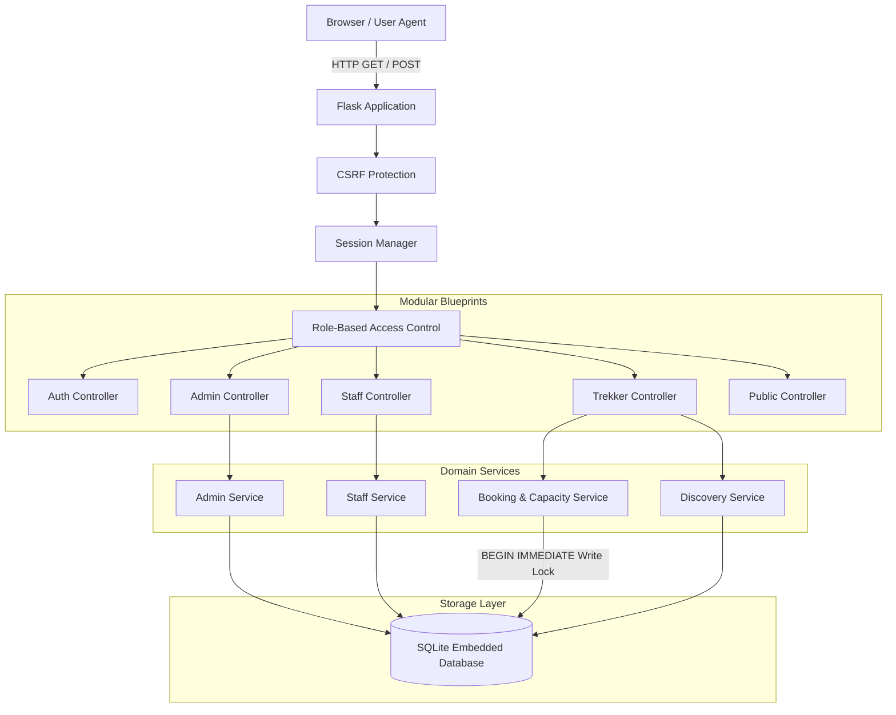
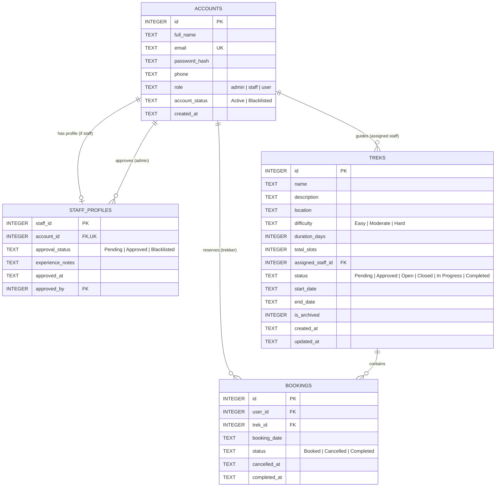
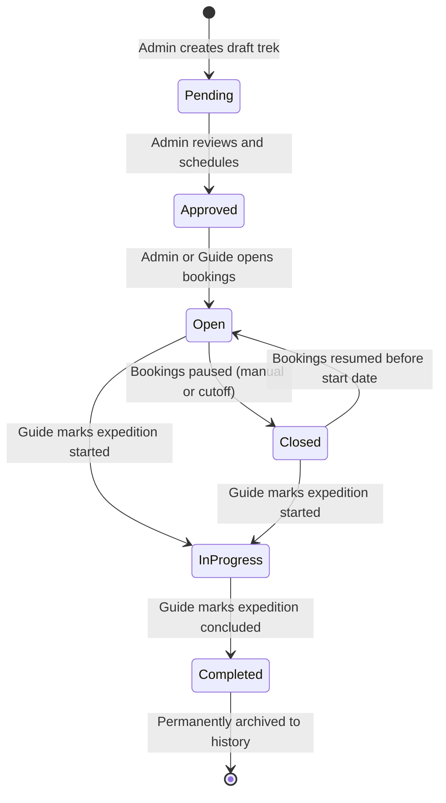
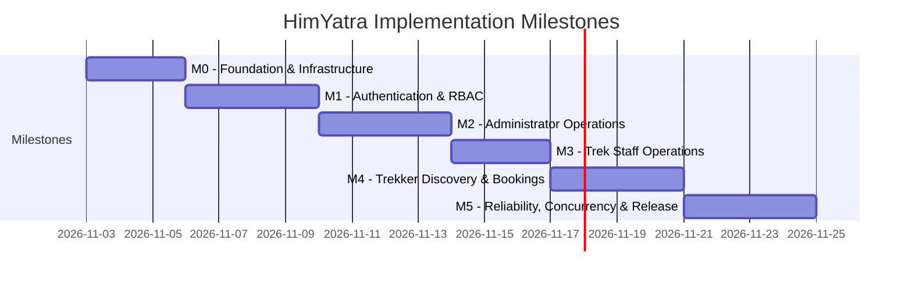

# HimYatra

> **Your Mountains. Your Journey. One Connected Expedition.**

[](https://www.python.org/)
[](https://flask.palletsprojects.com/)
[](https://www.sqlite.org/)
[](https://getbootstrap.com/)
[](#project-status)

HimYatra is a centralized Himalayan trekking and expedition operations management platform inspired by the rugged trails and expedition culture of Uttarakhand (Roopkund, Kedarkantha, Valley of Flowers, Har Ki Dun, Kuari Pass). 

It is engineered as an operational management system—not a generic commercial travel aggregator—delivering strict capacity controls, verified guide dispatch, multi-role governance, and immutable expedition audit trails.

---

## Project Status

> [!IMPORTANT]
> **Current Phase: Foundation & Specification.**  
> The project architecture, authoritative PRD, SQLite schema design, security controls, and development backlog are fully established. No application code has been implemented in this phase, preserving a clean boundary for disciplined development.

---

## Problem & Solution

### The Operational Challenge
Trekking organizations traditionally manage expedition schedules, slots, and field guides across ad-hoc spreadsheets and messaging threads. This creates acute operational risks:
* **Overbooking & Capacity Overselling:** Concurrent inquiries lead to more registrations than permitted camping or environmental quotas allow.
* **Unvetted Staff Dispatch:** Guides leading expeditions without prior administrative vetting, verification of mountain safety credentials, or clear operational assignment.
* **Data Desynchronization & Lost History:** Cancellations and completed treks are often overwritten or deleted, destroying participant safety records and historical records.
* **Insecure Role Isolation:** Staff altering expeditions managed by other guides, or trekkers accessing administrative registers.

### The HimYatra Solution
HimYatra consolidates expedition operations into a secure, server-rendered web application with:
1. **Dynamic Capacity Integrity:** Slot availability is derived in real time (`total_slots - active_booked_reservations`), protected against overselling down to the last seat via serialized SQLite write transactions.
2. **Three-Tier Role-Based Access Control (RBAC):** Distinct operational interfaces for Administrators, Approved Guides, and Trekkers.
3. **Staff Vetting Workflow:** Guide registrations enter a `Pending` state and are quarantined from operational dashboards until vetted and approved by an administrator.
4. **Permanent Audit Trail:** Historical reservations, cancellations, and completed expeditions are retained permanently for reporting and safety compliance.
5. **Zero-Client Fragility:** 100% of core operational workflows function seamlessly with client-side JavaScript disabled.

---

## Technology Stack

HimYatra strictly adheres to a robust, self-contained technology stack requiring zero external database installations or paid cloud services:

| Layer | Technology | Specification Mandate |
| :--- | :--- | :--- |
| **Backend** | Python 3.10+ | Core language |
| **Web Framework** | Flask 3.0+ | Server-side routing, request handling, session management |
| **Templating** | Jinja2 + HTML5 | Server-rendered dynamic pages and modular components |
| **Frontend Styling**| Vanilla CSS + Bootstrap 5 | Mountain-inspired responsive design system |
| **Database** | SQLite 3 | Embedded SQL engine with foreign keys and serialized transactions |
| **Client Scripting**| Optional Enhancement | Core operations **must work without JavaScript** |

*Note: Client-side SPA frameworks (React, Next.js, Vue), external database servers (PostgreSQL, MySQL, MongoDB), and background workers (Redis, Celery) are explicitly excluded from the core architecture.*

---

## System Architecture



---

## Role Permissions Matrix

| Capability / Action | Administrator (`admin`) | Approved Staff (`staff`) | Pending Staff | Trekker (`user`) |
| :--- | :---: | :---: | :---: | :---: |
| Self-Registration | ❌ (Pre-seeded only) | ❌ | ✅ Application form | ✅ User form |
| Login / Dashboard Access | ✅ `/admin` | ✅ `/staff` | ❌ Pending notice | ✅ `/user` |
| Create & Archive Treks | ✅ | ❌ | ❌ | ❌ |
| Edit Trek Core Details (Dates, Location) | ✅ | ❌ | ❌ | ❌ |
| Assign / Reassign Guides | ✅ | ❌ | ❌ | ❌ |
| Approve / Blacklist Staff | ✅ | ❌ | ❌ | ❌ |
| Blacklist Users | ✅ | ❌ | ❌ | ❌ |
| View System-Wide Booking Ledger | ✅ Global | ❌ | ❌ | ❌ |
| View Participant Roster | ✅ Global | ✅ Assigned trek only | ❌ | ❌ |
| Adjust Trek Slot Capacity | ✅ | ✅ (Floor: $\ge$ Booked) | ❌ | ❌ |
| Open / Close Trek Bookings | ✅ | ✅ Assigned trek only | ❌ | ❌ |
| Mark Trek `In Progress` / `Completed` | ✅ | ✅ Assigned trek only | ❌ | ❌ |
| Search & Filter Open Treks | ✅ | ✅ | ✅ | ✅ `/treks` |
| Book Open Expedition | ❌ | ❌ | ❌ | ✅ If slots available |
| Cancel Active Reservation | ❌ | ❌ | ❌ | ✅ Before start date |
| View Personal Booking History | ❌ (Admin ledger) | ❌ | ❌ | ✅ Own records only |
| Edit Profile Details | Optional | Recommended | ❌ | ✅ |

---

## Database Design

The system runs on a locally managed SQLite database with foreign key enforcement (`PRAGMA foreign_keys = ON;`).



### Core Integrity Constraints
1. **Dynamic Capacity Formula:**  
   $$\text{Available Slots} = \max\left(0, \text{total\_slots} - \text{COUNT}(\text{Bookings where } status = \text{'Booked'})\right)$$
2. **Duplicate Booking Prevention:** Enforced at both service level and database level via partial unique index:
   ```sql
   CREATE UNIQUE INDEX uq_active_booking_user_trek 
   ON bookings (user_id, trek_id) 
   WHERE status = 'Booked';
   ```
3. **Safe Capacity Floor:** Updates to `total_slots` must satisfy $\text{total\_slots} \ge \text{active Booked count}$.

---

## Trek Lifecycle

Treks progress through six distinct operational states:



* **Pending / Approved:** In preparation; not visible for public reservation.
* **Open:** Accepting reservations while seats remain and `start_date > CURRENT_DATE`.
* **Closed:** Pauses new reservations; existing reservations remain valid.
* **In Progress:** Expedition currently on the mountain. Booking window permanently closed.
* **Completed:** Concluded expedition. Active bookings marked `Completed`. History preserved.

---

## Booking & Concurrency Workflow

```mermaid
sequenceDiagram
    autonumber
    actor Trekker as Trekker
    participant Web as Flask Route (POST /treks/id/book)
    participant Svc as BookingService
    participant DB as SQLite DB

    Trekker->>Web: Submit booking request
    Web->>Svc: reserve_slot(user_id, trek_id)
    Svc->>DB: BEGIN IMMEDIATE; (Acquires exclusive write lock)
    Svc->>DB: Verify trek is Open, unarchived, and start_date > today
    Svc->>DB: Verify active Booked count < total_slots
    Svc->>DB: Verify user has no active Booked reservation
    alt Any check fails
        Svc->>DB: ROLLBACK;
        Svc-->>Web: Error (Fully booked / Ineligible)
        Web-->>Trekker: Render error notification
    else All checks pass
        Svc->>DB: INSERT INTO bookings (user_id, trek_id, status='Booked')
        Svc->>DB: COMMIT; (Releases lock)
        Svc-->>Web: Booking confirmed
        Web-->>Trekker: Redirect to /user/bookings with success banner
    end
```

---

## Proposed Project Structure

```
himyatra/
├── .github/                      # GitHub repository workflows and templates
│   └── pull_request_template.md  # PR verification checklist
├── docs/                         # Authoritative engineering documentation
│   ├── PRD.md                    # Authoritative Product Requirements Document
│   ├── ARCHITECTURE.md           # System architecture and request flow
│   ├── DATABASE_DESIGN.md        # Relational schema, DDL, and constraints
│   ├── USER_FLOWS.md             # End-to-end operational scenarios
│   ├── TESTING_STRATEGY.md       # Test matrix and concurrency test harness
│   ├── DECISIONS.md              # Architectural decisions and defaults
│   └── ISSUES_BACKLOG.md         # 28-issue development backlog across M0-M5
├── instance/                     # Local SQLite database (git-ignored)
├── CONTRIBUTING.md               # Branch and commit conventions
├── TODO.md                       # Project execution checklist
├── .editorconfig                 # Multi-editor formatting standards
├── .gitattributes               # Line ending normalization
├── .gitignore                    # Python and SQLite exclusion rules
└── README.md                     # Public project documentation
```

*(Application implementation files such as `app/`, `wsgi.py`, and `requirements.txt` are scheduled for Phase 1 under Milestone M0).*

---

## Local Setup & Development Instructions

### Prerequisites
* Python 3.10 or higher
* Git

### Step-by-Step Setup (For Upcoming Implementation Phase)

1. **Clone the Repository:**
   ```bash
   git clone https://github.com/chilkotiKartik/himyatra.git
   cd himyatra
   ```

2. **Create and Activate Virtual Environment:**
   ```bash
   python -m venv .venv
   # Windows PowerShell:
   .venv\Scripts\Activate.ps1
   # Linux / macOS:
   source .venv/bin/activate
   ```

3. **Install Dependencies:**
   ```bash
   pip install -r requirements.txt
   ```

4. **Initialize Database & Seed Administrator:**
   ```bash
   flask init-db
   flask seed-admin
   ```

5. **Start Local Development Server:**
   ```bash
   flask run --port=5000
   ```
   Open your browser and navigate to `http://127.0.0.1:5000`.

---

## Development Roadmap & Milestones

The development backlog is structured into 6 sequential milestones:



* **M0 — Foundation:** Project skeleton, Flask factory, SQLite connection, base templates ([Issues #1–#4](file:///c:/Users/chilk/Downloads/himyatra/himyatra/docs/ISSUES_BACKLOG.md#milestone-m0-foundation--project-infrastructure)).
* **M1 — Authentication:** Registration, login, admin seeding, RBAC decorators, blacklist barrier ([Issues #5–#9](file:///c:/Users/chilk/Downloads/himyatra/himyatra/docs/ISSUES_BACKLOG.md#milestone-m1-identity-authentication--rbac)).
* **M2 — Administrator:** Metrics dashboard, trek CRUD, staff vetting queue, accounts directory ([Issues #10–#14](file:///c:/Users/chilk/Downloads/himyatra/himyatra/docs/ISSUES_BACKLOG.md#milestone-m2-administrator-operations)).
* **M3 — Trek Staff:** Assigned expedition workspace, participant roster, capacity adjust, status transitions ([Issues #15–#18](file:///c:/Users/chilk/Downloads/himyatra/himyatra/docs/ISSUES_BACKLOG.md#milestone-m3-trek-staff-expedition-management)).
* **M4 — Trekker & Bookings:** Trek discovery, search/filtering, detail view, booking ledger, cancellations ([Issues #19–#23](file:///c:/Users/chilk/Downloads/himyatra/himyatra/docs/ISSUES_BACKLOG.md#milestone-m4-trekker-discovery--booking-ledger)).
* **M5 — Reliability:** Atomic transactions, automated test suites, demo seeding, zero-JS audit ([Issues #24–#28](file:///c:/Users/chilk/Downloads/himyatra/himyatra/docs/ISSUES_BACKLOG.md#milestone-m5-reliability-concurrency--release)).

---

## Verification & Testing Strategy

Testing is structured to validate all 20 acceptance scenarios defined in the project specification:
* **Role Isolation:** Direct URL tampering for unauthorized roles returns HTTP 403.
* **Concurrency Verification:** Multi-threaded simulation of concurrent requests for the final available seat (`tests/test_concurrency.py`).
* **Zero-JavaScript Usability:** Verification that all routes, filters, and forms execute cleanly via standard HTTP POST/GET.

---

## Security Architecture

* **Cryptographic Password Hashing:** Werkzeug `generate_password_hash` using `scrypt` / `pbkdf2`. Plaintext passwords are never stored or logged.
* **CSRF Protection:** Server-side verification on all state-modifying POST requests.
* **SQL Injection Immunity:** Strict use of parameterized queries (`?`) across all SQLite interactions. Direct string concatenation is forbidden.
* **XSS Defense:** Automatic Jinja2 contextual HTML escaping. Untrusted user inputs are never marked `safe`.
* **Session Invalidation:** Deactivating or blacklisting an account immediately revokes access across active sessions on subsequent requests.

---

## Contributing

Please review [CONTRIBUTING.md](file:///c:/Users/chilk/Downloads/himyatra/himyatra/CONTRIBUTING.md) for branch naming conventions (`feature/`, `fix/`, `docs/`, `test/`), conventional commit guidelines, and pull request requirements.

---

## License

*License pending confirmation by repository owner.*
