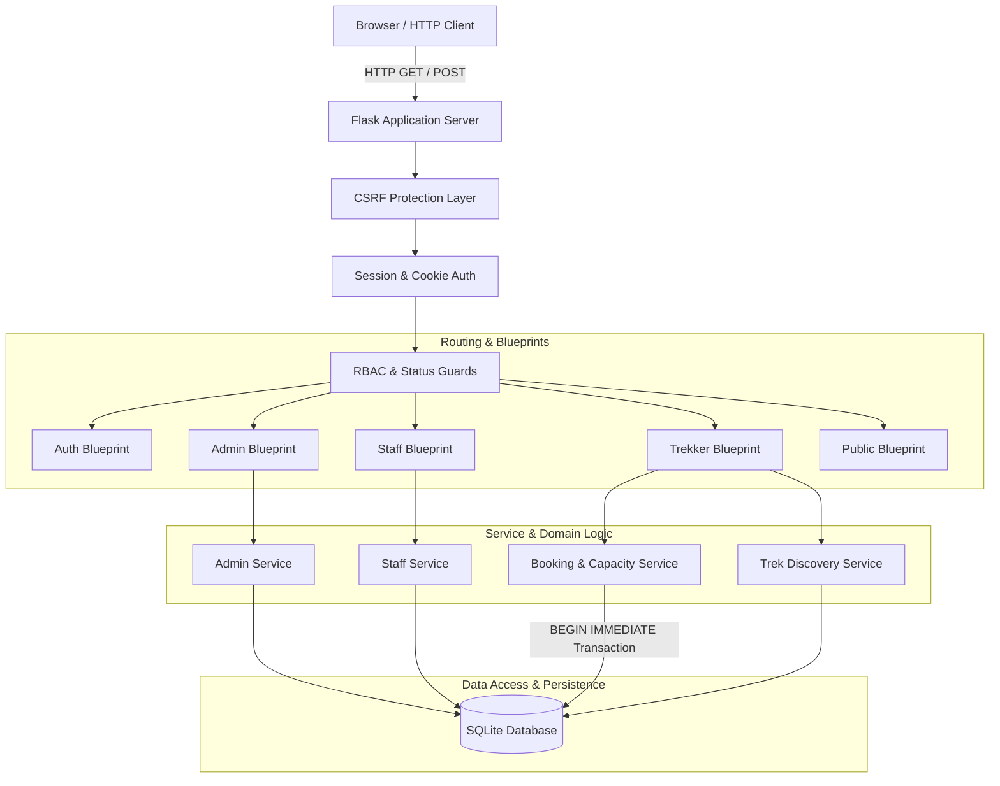

# System Architecture & Technical Specification

**Product Name:** HimYatra  
**Category:** Himalayan Trekking & Expedition Operations Management System  
**Target Environment:** Local Python / Flask runtime with embedded SQLite  

---

## 1. Architectural Philosophy

HimYatra is architected as a modular, server-side rendered (SSR) monolithic web application using Python and Flask. The architectural focus is on:
1. **Zero-Client Fragility:** Complete core operational capability without relying on client-side JavaScript execution.
2. **ACID Transaction Integrity:** Using SQLite's native `BEGIN IMMEDIATE` write transactions to serialize critical booking operations and prevent overselling.
3. **Decoupled Module Layering:** Strict separation of routing (Blueprints), business domain logic (Services), data persistence (Repository/Models), and security enforcement (Decorators).



---

## 2. Directory Layout & Module Responsibilities

The codebase follows a production-ready application factory pattern:

```
himyatra/
├── app/
│   ├── __init__.py           # Application factory (create_app), extensions registration
│   ├── config.py             # Environment configurations (Development, Testing, Production)
│   ├── database.py           # SQLite connection manager, row factory, PRAGMA setup
│   ├── schema.sql            # SQLite DDL schema with constraints and partial indexes
│   ├── decorators.py         # @login_required, @role_required, @verified_staff_required
│   ├── cli.py                # Flask CLI commands (init-db, seed-admin, seed-demo)
│   ├── services/             # Pure Python domain logic & business rules
│   │   ├── auth_service.py   # Password hashing, authentication, session validation
│   │   ├── booking_service.py# Atomic booking transactions, slot math, cancellations
│   │   ├── trek_service.py   # Trek lifecycle transitions, capacity floor validation
│   │   └── admin_service.py  # Staff approvals, blacklisting, global reporting
│   ├── routes/               # Modular Flask Blueprints
│   │   ├── auth.py           # /login, /logout, /register/*
│   │   ├── admin.py          # /admin/*
│   │   ├── staff.py          # /staff/*
│   │   ├── user.py           # /user/*
│   │   └── public.py         # /, /treks, /treks/<id>
│   ├── static/
│   │   ├── css/
│   │   │   └── custom.css    # Mountain theme styling, typography, responsive tweaks
│   │   └── img/              # Mountain identity assets & logos
│   └── templates/
│       ├── base.html         # Base template with responsive navbar and alert banners
│       ├── auth/             # login.html, register_user.html, register_staff.html
│       ├── admin/            # dashboard.html, treks.html, staff.html, accounts.html, bookings.html
│       ├── staff/            # dashboard.html, trek_detail.html
│       ├── user/             # dashboard.html, bookings.html, profile.html
│       ├── public/           # index.html, treks.html, trek_detail.html
│       └── errors/           # 400.html, 403.html, 404.html, 500.html
├── instance/                 # Local SQLite database (himyatra.db - excluded from Git)
├── tests/                    # Unit, integration, and concurrency test suites
├── docs/                     # Technical specifications, PRD, and architecture diagrams
├── requirements.txt          # Python runtime dependencies
├── wsgi.py                   # Application entrypoint
├── CONTRIBUTING.md           # Development and review standards
├── TODO.md                   # Project implementation checklist
└── README.md                 # Public documentation and setup guide
```

---

## 3. Request Lifecycle & Authentication Flow

```mermaid
sequenceDiagram
    autonumber
    actor User as Trekker / Staff / Admin
    participant App as Flask Router
    participant Guard as RBAC Guard
    participant Svc as Domain Service
    participant DB as SQLite DB

    User->>App: POST /login (email, password)
    App->>DB: Query account by normalized email
    DB-->>App: account record (hash, role, status)
    App->>App: Verify password hash (scrypt/pbkdf2)
    alt Invalid Credentials or Blacklisted
        App-->>User: Render error notice ("Invalid credentials or account disabled")
    else Valid Credentials
        App->>App: Store session (user_id, role, status)
        alt Admin
            App-->>User: Redirect to /admin
        alt Approved Staff
            App-->>User: Redirect to /staff
        alt Pending Staff
            App-->>User: Redirect to /staff/pending-notice
        alt Active Trekker
            App-->>User: Redirect to /user
        end
    end
```

---

## 4. Atomic Booking Transaction Architecture

To eliminate race conditions when multiple trekkers attempt to book the final remaining slot on a popular Himalayan trek, the system implements **SQLite Write-Lock Serialization**:

```mermaid
sequenceDiagram
    autonumber
    actor Trekker as Authenticated Trekker
    participant Route as POST /treks/<id>/book
    participant Service as BookingService
    participant DB as SQLite Engine

    Trekker->>Route: Submit booking form (CSRF token verified)
    Route->>Service: reserve_slot(user_id, trek_id)
    Service->>DB: BEGIN IMMEDIATE; (Acquires exclusive write reservation lock)
    
    Service->>DB: SELECT status, start_date, total_slots, is_archived FROM treks WHERE id = ?
    Note over Service,DB: Check 1: Trek must be Open, not archived, start_date > today
    
    Service->>DB: SELECT COUNT(*) FROM bookings WHERE trek_id = ? AND status = 'Booked'
    Note over Service,DB: Check 2: booked_count < total_slots
    
    Service->>DB: SELECT id FROM bookings WHERE user_id = ? AND trek_id = ? AND status = 'Booked'
    Note over Service,DB: Check 3: Duplicate booking prohibition
    
    alt Any Check Fails
        Service->>DB: ROLLBACK;
        Service-->>Route: Raise DomainValidationError(reason)
        Route-->>Trekker: Flash error banner & redirect to /treks/<id>
    else All Checks Pass
        Service->>DB: INSERT INTO bookings (user_id, trek_id, booking_date, status) VALUES (?, ?, CURRENT_TIMESTAMP, 'Booked')
        Service->>DB: COMMIT; (Releases write lock)
        Service-->>Route: Success(booking_id)
        Route-->>Trekker: Flash success banner & redirect to /user/bookings
    end
```

### Why `BEGIN IMMEDIATE`?
By default, SQLite starts transactions in `DEFERRED` mode, acquiring a read lock first and only upgrading to a write lock when a mutation statement occurs. Under high concurrency, two readers could both verify availability before one attempts to upgrade, triggering a `SQLITE_BUSY` or deadlock error. 

By acquiring `BEGIN IMMEDIATE`, the connection immediately reserves write access, guaranteeing that no other thread or request can insert a booking until the transaction concludes.

---

## 5. Security & Session Integrity Architecture

1. **Session Revocation on Blacklist:** Every protected request invokes a `load_logged_in_user` hook that checks the latest database status. If an admin blacklists an account, the active session is terminated instantly on the subsequent HTTP hit.
2. **Role Isolation Decorators:**
   * `@login_required`: Asserts session existence.
   * `@role_required('admin')`: Restricts access to superusers.
   * `@verified_staff_required`: Asserts account role is `staff` AND `approval_status == 'Approved'`.
   * `@trek_owner_required`: Asserts that `trek.assigned_staff_id == session['user_id']`.
3. **Template Context Processors:** Expose user identity and active roles to Jinja2 safely without embedding sensitive fields into HTML output.
