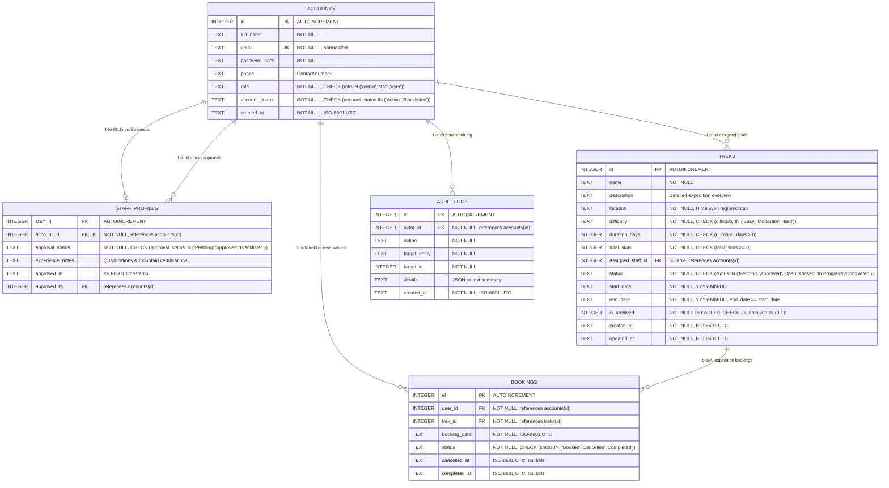

# Database Design & Schema Specification

**Product Name:** HimYatra  
**Database Engine:** SQLite 3  
**Storage Location:** `instance/himyatra.db` (Local application instance directory)  
**Foreign Keys:** Strictly Enforced via `PRAGMA foreign_keys = ON;`  

---

## 1. Entity-Relationship Overview



---

## 2. Table Schemas, Constraints & Indexes

### 2.1 Table: `accounts`
Stores primary authentication identities and system-wide authorization roles.

```sql
CREATE TABLE accounts (
    id INTEGER PRIMARY KEY AUTOINCREMENT,
    full_name TEXT NOT NULL CHECK(length(trim(full_name)) > 0),
    email TEXT NOT NULL UNIQUE CHECK(email LIKE '%_@_%._%'),
    password_hash TEXT NOT NULL,
    phone TEXT,
    role TEXT NOT NULL CHECK(role IN ('admin', 'staff', 'user')),
    account_status TEXT NOT NULL DEFAULT 'Active' CHECK(account_status IN ('Active', 'Blacklisted')),
    created_at TEXT NOT NULL DEFAULT (strftime('%Y-%m-%dT%H:%M:%SZ', 'now'))
);

CREATE INDEX idx_accounts_email ON accounts(email);
CREATE INDEX idx_accounts_role ON accounts(role);
CREATE INDEX idx_accounts_status ON accounts(account_status);
```

### 2.2 Table: `staff_profiles`
Holds verification status and credentials for guides.

```sql
CREATE TABLE staff_profiles (
    staff_id INTEGER PRIMARY KEY AUTOINCREMENT,
    account_id INTEGER NOT NULL UNIQUE,
    approval_status TEXT NOT NULL DEFAULT 'Pending' CHECK(approval_status IN ('Pending', 'Approved', 'Blacklisted')),
    experience_notes TEXT,
    approved_at TEXT,
    approved_by INTEGER,
    FOREIGN KEY (account_id) REFERENCES accounts(id) ON DELETE RESTRICT,
    FOREIGN KEY (approved_by) REFERENCES accounts(id) ON DELETE SET NULL
);

CREATE INDEX idx_staff_profiles_approval ON staff_profiles(approval_status);
```

### 2.3 Table: `treks`
Stores Himalayan expedition parameters, guide assignments, and lifecycle states.

```sql
CREATE TABLE treks (
    id INTEGER PRIMARY KEY AUTOINCREMENT,
    name TEXT NOT NULL CHECK(length(trim(name)) > 0),
    description TEXT,
    location TEXT NOT NULL CHECK(length(trim(location)) > 0),
    difficulty TEXT NOT NULL CHECK(difficulty IN ('Easy', 'Moderate', 'Hard')),
    duration_days INTEGER NOT NULL CHECK(duration_days > 0),
    total_slots INTEGER NOT NULL CHECK(total_slots >= 0),
    assigned_staff_id INTEGER,
    status TEXT NOT NULL DEFAULT 'Pending' CHECK(status IN ('Pending', 'Approved', 'Open', 'Closed', 'In Progress', 'Completed')),
    start_date TEXT NOT NULL,
    end_date TEXT NOT NULL,
    is_archived INTEGER NOT NULL DEFAULT 0 CHECK(is_archived IN (0, 1)),
    created_at TEXT NOT NULL DEFAULT (strftime('%Y-%m-%dT%H:%M:%SZ', 'now')),
    updated_at TEXT NOT NULL DEFAULT (strftime('%Y-%m-%dT%H:%M:%SZ', 'now')),
    CHECK(end_date >= start_date),
    FOREIGN KEY (assigned_staff_id) REFERENCES accounts(id) ON DELETE SET NULL
);

CREATE INDEX idx_treks_status ON treks(status);
CREATE INDEX idx_treks_dates ON treks(start_date, end_date);
CREATE INDEX idx_treks_difficulty ON treks(difficulty);
CREATE INDEX idx_treks_location ON treks(location);
CREATE INDEX idx_treks_assigned_staff ON treks(assigned_staff_id);
CREATE INDEX idx_treks_archived ON treks(is_archived);
```

### 2.4 Table: `bookings`
Tracks expedition reservations, cancellations, and completed participations.

```sql
CREATE TABLE bookings (
    id INTEGER PRIMARY KEY AUTOINCREMENT,
    user_id INTEGER NOT NULL,
    trek_id INTEGER NOT NULL,
    booking_date TEXT NOT NULL DEFAULT (strftime('%Y-%m-%dT%H:%M:%SZ', 'now')),
    status TEXT NOT NULL DEFAULT 'Booked' CHECK(status IN ('Booked', 'Cancelled', 'Completed')),
    cancelled_at TEXT,
    completed_at TEXT,
    FOREIGN KEY (user_id) REFERENCES accounts(id) ON DELETE RESTRICT,
    FOREIGN KEY (trek_id) REFERENCES treks(id) ON DELETE RESTRICT
);

-- Partial Unique Index: Guarantees a trekker can only hold ONE active 'Booked' reservation per trek.
-- Trekkers can re-book after cancelling without violating uniqueness.
CREATE UNIQUE INDEX uq_active_booking_user_trek 
ON bookings (user_id, trek_id) 
WHERE status = 'Booked';

CREATE INDEX idx_bookings_user_id ON bookings(user_id);
CREATE INDEX idx_bookings_trek_id ON bookings(trek_id);
CREATE INDEX idx_bookings_status ON bookings(status);
```

### 2.5 Table: `audit_logs` (Optional Traceability Table)
```sql
CREATE TABLE audit_logs (
    id INTEGER PRIMARY KEY AUTOINCREMENT,
    actor_id INTEGER NOT NULL,
    action TEXT NOT NULL,
    target_entity TEXT NOT NULL,
    target_id INTEGER NOT NULL,
    details TEXT,
    created_at TEXT NOT NULL DEFAULT (strftime('%Y-%m-%dT%H:%M:%SZ', 'now')),
    FOREIGN KEY (actor_id) REFERENCES accounts(id) ON DELETE RESTRICT
);

CREATE INDEX idx_audit_logs_actor ON audit_logs(actor_id);
CREATE INDEX idx_audit_logs_entity ON audit_logs(target_entity, target_id);
```

---

## 3. Dynamic Capacity & Slot Calculations

Capacity is computed dynamically from real-time records to eliminate data desynchronization bugs:

```sql
-- Query to retrieve remaining available slots for a given trek:
SELECT 
    t.id,
    t.name,
    t.total_slots,
    COUNT(CASE WHEN b.status = 'Booked' THEN 1 END) AS active_booked_count,
    MAX(0, t.total_slots - COUNT(CASE WHEN b.status = 'Booked' THEN 1 END)) AS available_slots
FROM treks t
LEFT JOIN bookings b ON t.id = b.trek_id
WHERE t.id = ? AND t.is_archived = 0
GROUP BY t.id;
```

---

## 4. Migration & Schema Initialization Strategy

1. **Schema Initialization (`schema.sql`):** Executed during `flask init-db`. Uses `CREATE TABLE IF NOT EXISTS`.
2. **Initial Superuser Seeding:** Executed programmatically during application boot or via `flask seed-admin`. Checks for the existence of an `admin` role account; if absent, prompts or loads configured environment credentials and inserts the hashed record.
3. **Data Integrity Verification:** Foreign key constraints are validated on every database connection using Python's SQLite hook:
   ```python
   def get_db():
       conn = sqlite3.connect(current_app.config['DATABASE'])
       conn.execute("PRAGMA foreign_keys = ON;")
       conn.row_factory = sqlite3.Row
       return conn
   ```
