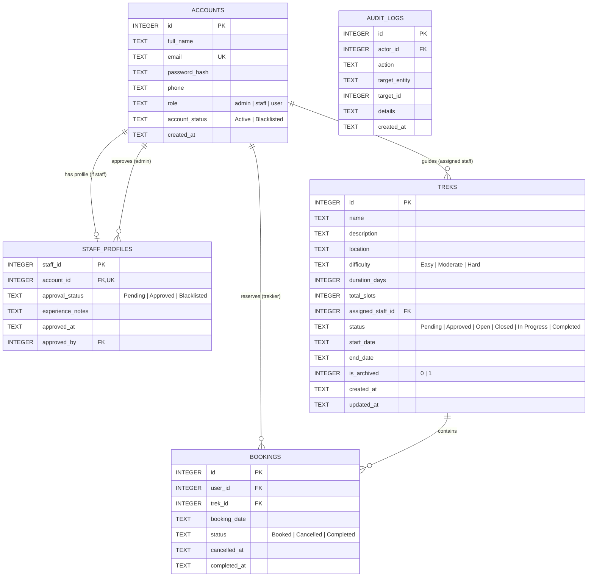

# Product Requirements Document (PRD)

**Product Name:** HimYatra  
**Category:** Himalayan Trekking & Expedition Operations Management System  
**Tagline:** *Your Mountains. Your Journey. One Connected Expedition.*  
**Document Version:** 1.0  
**Status:** Approved for Foundation & Backlog Engineering  
**Date:** 02 November 2026  
**Authoritative Source:** `Trekking_Management_Detailed_Project_Specification.pdf` (Version 1.0, 01 Nov 2026)  

---

## 1. Executive Summary & Problem Statement

### 1.1 Context & Background
Trekking organizations in the Indian Himalayas (particularly across Uttarakhand circuits such as Roopkund, Kedarkantha, Valley of Flowers, Har Ki Dun, and Kuari Pass) coordinate expedition schedules, multi-day itineraries, participant capacities, field guides, and trekking permits. Traditionally, these operations rely on dispersed spreadsheets, instant messaging channels, and handwritten ledgers.

### 1.2 The Problem
Manual and fragmented coordination causes significant operational failures:
1. **Capacity Overselling & Double Bookings:** Inability to track available slots in real time under concurrent inquiries.
2. **Ambiguous Staff Governance:** Guides leading expeditions without formal administrator verification, safety vetting, or explicit operational assignment.
3. **Loss of Historical Audit Trail:** Cancelled or completed expeditions being erased or overwritten, leaving organizers without participant history, emergency contact registers, or completion logs.
4. **Vulnerable Access Control:** Lack of role isolation allowing staff to alter unassigned itineraries or regular users to access privileged dispatch registers.

### 1.3 The Solution: HimYatra
HimYatra is an operational management platform designed to centralize expedition scheduling, verified staff dispatch, regulated trekker reservations, strict seat capacity quotas, and end-to-end expedition lifecycles within a secure, robust, server-rendered web application.

---

## 2. Goals & Success Metrics

### 2.1 Primary Objectives
* **GOAL-01 (Single Source of Truth):** Maintain an accurate, real-time record for every trek, its assigned guide, registered participants, and lifecycle status.
* **GOAL-02 (Zero Overbooking Integrity):** Ensure available seats equal `total_slots - active_booked_reservations` at all times, with strict database transaction serialization preventing overselling down to the last seat.
* **GOAL-03 (Strict Role-Based Access Control):** Enforce server-side authorization separating Administrator, Approved Staff, and Trekker operations.
* **GOAL-04 (Account Lifecycle & Vetting):** Require administrative approval for staff accounts before any guide operations, with instant account blacklisting capability that terminates active operations.
* **GOAL-05 (Immutable Historical Traceability):** Preserve past participant rosters, completed expeditions, and cancellations without physical deletion.
* **GOAL-06 (Self-Contained Local Execution):** Enable complete deployment and evaluation on a standard machine using Python, Flask, and an embedded SQLite database without external server installations or paid services.

---

## 3. Technology Stack & Architectural Constraints

| Layer | Mandated Technology | Specification Rule |
| :--- | :--- | :--- |
| **Backend Framework** | Python 3.10+ with Flask | Core application server, routing, session handling, view logic. |
| **Frontend Templating**| Jinja2 with Semantic HTML5 | Server-side rendered layouts, modular component inclusion. |
| **Styling** | Vanilla CSS + Bootstrap 5 | Responsive, clean mountain-aesthetic interface. |
| **Database Engine** | SQLite (Embedded) | Programmatic schema initialization, foreign keys enabled (`PRAGMA foreign_keys = ON`), serialized transaction locking. |
| **JavaScript Policy** | Progressive Enhancement Only | **Core operations must function 100% with JavaScript disabled.** |
| **Prohibited Technologies** | React, Next.js, Vue, PostgreSQL, MySQL, Redis, Celery, MongoDB | Must not be introduced. |

---

## 4. User Roles & Permission Matrix

### 4.1 Role Profiles
1. **Administrator (`admin`):**
   * Pre-existing system superuser created programmatically via database setup / seed CLI.
   * Public administrator self-registration is strictly prohibited.
   * Full operational authority over treks, staff approvals, account statuses, guide assignments, and system-wide booking registers.
2. **Trek Staff / Guide (`staff`):**
   * Registers via a dedicated staff registration portal.
   * Begins in `Pending` state; cannot view or operate staff dashboards until approved by an administrator.
   * Once approved, manages **only treks explicitly assigned to them** by the administrator.
   * Permitted actions on assigned treks: view participant rosters, update slot capacity (subject to constraints), open/close trek bookings, mark expedition started (`In Progress`) and finished (`Completed`).
   * Forbidden actions: managing unassigned treks, assigning guides, creating or deleting treks, approving peers, modifying user profiles.
3. **Trekker (`user`):**
   * Registers independently and logs in.
   * Discovers and searches approved/open Himalayan treks.
   * Reserves available slots on open treks before the expedition start date.
   * Views personal booking history (Booked, Cancelled, Completed) and manages own profile.
   * Forbidden actions: viewing other trekkers' reservations, accessing staff/admin controls.

### 4.2 Comprehensive Permission Matrix

| Capability / Route Operation | Administrator | Approved Staff | Pending Staff | Trekker (Active) | Blacklisted User |
| :--- | :---: | :---: | :---: | :---: | :---: |
| Public Self-Registration | ❌ Prohibited | ❌ | ❌ | ✅ User Form | ❌ |
| Staff Self-Registration | ❌ | ❌ | ✅ Staff Form | ❌ | ❌ |
| Programmatic Superuser Seeding | ✅ Setup CLI | ❌ | ❌ | ❌ | ❌ |
| Login / Session Creation | ✅ | ✅ | ✅ (Restricted) | ✅ | ❌ Denied |
| View System Admin Dashboard | ✅ | ❌ | ❌ | ❌ | ❌ |
| Create New Trek | ✅ | ❌ | ❌ | ❌ | ❌ |
| Edit Trek Core Details (Name, Dates, Location) | ✅ | ❌ | ❌ | ❌ | ❌ |
| Assign / Reassign Staff to Trek | ✅ | ❌ | ❌ | ❌ | ❌ |
| Archive / Soft-Delete Trek | ✅ | ❌ | ❌ | ❌ | ❌ |
| Review & Approve Staff Applications | ✅ | ❌ | ❌ | ❌ | ❌ |
| Blacklist / Restore Any Account | ✅ | ❌ | ❌ | ❌ | ❌ |
| View Global Bookings Audit History | ✅ | ❌ | ❌ | ❌ | ❌ |
| View Staff Dashboard | ❌ (Admin view) | ✅ (Assigned only) | ❌ Pending Banner | ❌ | ❌ |
| Update Assigned Trek Slots (Capacity) | ✅ | ✅ (>= Booked count) | ❌ | ❌ | ❌ |
| Toggle Open / Closed Status on Assigned Trek | ✅ | ✅ (Before start date) | ❌ | ❌ | ❌ |
| Mark Assigned Trek Started (`In Progress`) | ✅ | ✅ | ❌ | ❌ | ❌ |
| Mark Assigned Trek `Completed` | ✅ | ✅ | ❌ | ❌ | ❌ |
| View Participant Roster | ✅ Global | ✅ Assigned trek only | ❌ | ❌ | ❌ |
| Browse & Search Open Treks | ✅ | ✅ | ✅ | ✅ | ❌ |
| View Trek Details Page | ✅ | ✅ | ✅ | ✅ | ❌ |
| Book a Slot on Open Trek | ❌ (Not intended) | ❌ (Not intended) | ❌ | ✅ (If capacity > 0) | ❌ |
| Cancel Own Active Booking | ❌ | ❌ | ❌ | ✅ (Before start date)| ❌ |
| View Personal Booking History | ❌ (Admin view) | ❌ | ❌ | ✅ Own records only | ❌ |
| Update Personal Profile | ❌ | Recommended | ❌ | ✅ | ❌ |

---

## 5. Functional Requirements

### 5.1 Authentication & Account Management
* **FR-001 (Dual Registration):** The system shall provide distinct registration routes for Trekkers (`/register/user`) and Trek Staff (`/register/staff`).
* **FR-002 (Staff Pending State):** Upon staff registration, the account record must be created with role `staff`, and an associated `staff_profiles` row with `approval_status = 'Pending'`.
* **FR-003 (Admin Self-Registration Prohibition):** The system shall not expose any public registration form or route for administrative accounts.
* **FR-004 (Admin Seed Initialization):** An administrative account must be provisioned via a programmatic setup script or CLI command (`python -m app.cli init-admin` or during initial DB initialization).
* **FR-005 (Credential Security):** Passwords must be hashed using secure hashing algorithms (Werkzeug `generate_password_hash` with `scrypt` or `pbkdf2:sha256`). Plaintext passwords must never be stored, logged, or flashed.
* **FR-006 (Unified Role-Aware Login):** The system shall provide a single `/login` route that validates credentials and directs authenticated accounts to their role-specific dashboard (`/admin`, `/staff`, or `/user`).
* **FR-007 (Immediate Blacklist Enforcement):** When an account status is set to `Blacklisted`, all further protected requests—including those from pre-existing active sessions—must be immediately denied with a 403 Forbidden or session termination.
* **FR-008 (Pending Staff Access Barrier):** When a staff member with `approval_status = 'Pending'` logs in, they must be redirected to an informational notice explaining that account verification is awaiting administrative review. They must be prevented from accessing any operational staff route (`/staff/*`).
* **FR-009 (Session Termination):** The `/logout` route shall invalidate the server session and clear client session cookies via POST.

### 5.2 Administrator Operations
* **FR-010 (Admin Metrics Dashboard):** The `/admin` dashboard must query the database to display real-time counters: Total Treks, Total Active Trekkers, Total Registered Staff, Total Bookings, Pending Staff Approvals, and Open Treks. Hard-coded counts are prohibited.
* **FR-011 (Trek Creation):** Administrators shall create treks specifying: name, description (optional), Himalayan location, difficulty rating (`Easy`, `Moderate`, `Hard`), duration in days (`> 0`), total capacity slots (`>= 0`), start date, end date (`end_date >= start_date`), and initial status (`Pending` or `Approved`).
* **FR-012 (Staff Assignment):** Administrators shall assign an approved, non-blacklisted staff member as the primary guide for a trek. Pending or blacklisted staff must be excluded from selection.
* **FR-013 (Trek Archiving / Soft-Delete):** If an administrator deletes a trek that contains booking records, the system must set `is_archived = 1` rather than physically deleting the database row, preserving all audit and participant records.
* **FR-014 (Staff Approval & Rejection):** Administrators shall view a dedicated queue of Pending staff applications (`/admin/staff`) displaying full name, email, phone, experience notes, and registration date, with atomic `Approve` and `Blacklist` actions.
* **FR-015 (User & Staff Management / Search):** The `/admin/accounts` route shall list all user and staff accounts with filterable search supporting case-insensitive name fragments and exact account ID lookups.
* **FR-016 (Global Booking Audit Register):** Administrators shall have a unified interface (`/admin/bookings`) displaying all historical and active reservations across all treks, filterable by trek, user, and status (`Booked`, `Cancelled`, `Completed`).

### 5.3 Trek Staff Operations
* **FR-017 (Assigned Expedition Dashboard):** The `/staff` dashboard shall query and display only treks where `assigned_staff_id` matches the authenticated staff account. If no treks are assigned, an explicit empty state ("No treks assigned yet") must be presented.
* **FR-018 (Ownership Enforcement):** The server must verify that the authenticated staff account owns the requested trek ID on every `/staff/treks/<id>` request. Accessing another guide's trek must return HTTP 403 Forbidden.
* **FR-019 (Assigned Trek Participant Roster):** Staff members can view the participant roster for their assigned trek, including Booking ID, Trekker Full Name, Phone, Booking Date, and Status.
* **FR-020 (Slot Capacity Adjustment):** Staff may modify the `total_slots` for their assigned trek, provided the new value is not lower than the current count of confirmed `Booked` participants.
* **FR-021 (Trek Status Transitions - Staff):** Staff may toggle the trek status between `Open` and `Closed` prior to the expedition start date.
* **FR-022 (Expedition Start Workflow):** Staff may transition their assigned trek to `In Progress`. Once started, new bookings are permanently blocked.
* **FR-023 (Expedition Completion Workflow):** Staff may transition an `In Progress` trek to `Completed`. Active `Booked` participant records are transitioned to `Completed`.

### 5.4 Trekker Operations
* **FR-024 (Trekker Dashboard):** The `/user` dashboard shall display a summary of the trekker's active and historical reservations, alongside a curated list of featured `Open` expeditions.
* **FR-025 (Discovery, Search & Filtering):** Trekkers can browse open expeditions at `/treks`, searching by name/location keywords and filtering by difficulty (`Easy`, `Moderate`, `Hard`). Results must only include treks with `status = 'Open'`, `is_archived = 0`, and future start dates.
* **FR-026 (Trek Detail View):** The `/treks/<id>` page shall display complete expedition parameters: name, description, location, difficulty, duration, dates, assigned guide name, and real-time available slots.
* **FR-027 (Atomic Booking Submission):** Eligible trekkers can submit a booking request for an open trek via POST `/treks/<id>/book`.
* **FR-028 (Personal Booking Ledger):** Trekkers can view their complete personal booking history at `/user/bookings` showing trek details, booking dates, and statuses (`Booked`, `Cancelled`, `Completed`).
* **FR-029 (Self-Service Cancellation):** Trekkers may cancel an active `Booked` reservation on an upcoming trek before its scheduled start date. The booking status transitions to `Cancelled`, releasing one slot back to available capacity.
* **FR-030 (Profile Management):** Trekkers may update their contact phone number and full name at `/user/profile`. If email update is supported, uniqueness must be strictly re-validated.

---

## 6. Critical Business Rules (BR)

* **BR-001 (Valid Trek Lifecycle States):** Treks must exist in exactly one of six states: `Pending`, `Approved`, `Open`, `Closed`, `In Progress`, `Completed`.
* **BR-002 (Bookable Eligibility Rule):** A trek is bookable if and only if:
  1. `status == 'Open'`
  2. `is_archived == 0`
  3. `CURRENT_DATE < start_date`
  4. `available_slots > 0`
* **BR-003 (Dynamic Seat Availability Formula):**
  $$\text{Available Slots} = \max\left(0, \text{total\_slots} - \text{COUNT}(\text{Bookings where } status = \text{'Booked'})\right)$$
  Cancelled (`Cancelled`) and completed (`Completed`) bookings do not occupy active capacity.
* **BR-004 (Capacity Reduction Floor):** An administrator or staff member cannot decrease `total_slots` to a value less than the count of active `Booked` reservations:
  $$\text{new\_total\_slots} \ge \text{COUNT}(\text{Bookings with } status = \text{'Booked'})$$
* **BR-005 (Duplicate Active Booking Prohibition):** A single trekker cannot hold more than one concurrent `Booked` reservation for the same trek. If a trekker previously cancelled their booking on that trek, they are eligible to book again, provided seats remain.
* **BR-006 (Booking Concurrency & Write Lock):** All booking validations (status check, cutoff date check, duplicate booking check, remaining seat calculation) and the booking insertion must execute within a single atomic SQLite transaction using `BEGIN IMMEDIATE` to serialize concurrent requests.
* **BR-007 (Past Date Booking Prohibition):** No booking shall be accepted on or after the trek's scheduled `start_date`.
* **BR-008 (Guide Assignment Qualification):** Only staff accounts with `role = 'staff'`, `account_status = 'Active'`, and `approval_status = 'Approved'` may be assigned to a trek.
* **BR-009 (Immutability of Historical Bookings):** Booking records must never be deleted from the database. Status updates (`Booked` $\to$ `Cancelled` or `Booked` $\to$ `Completed`) with timestamp tracking must be used.
* **BR-010 (Post-Completion Reopening Ban):** Once a trek is marked `Completed`, it cannot be reverted to `Open`, `Approved`, or `Pending`.

---

## 7. Data Architecture & SQLite Schema Specification

The database file shall reside in the application's `instance/` directory (`instance/himyatra.db`). All foreign key constraints must be enforced via `PRAGMA foreign_keys = ON;`.



### 7.1 Table Specifications
* **`accounts`**: Stores login identities for all three roles. Unique index on `email`. Check constraint on `role IN ('admin', 'staff', 'user')` and `account_status IN ('Active', 'Blacklisted')`.
* **`staff_profiles`**: 1-to-0/1 relationship with `accounts` where `role = 'staff'`. Unique foreign key on `account_id`. Check constraint on `approval_status IN ('Pending', 'Approved', 'Blacklisted')`.
* **`treks`**: Core expedition data. Check constraints: `difficulty IN ('Easy', 'Moderate', 'Hard')`, `duration_days > 0`, `total_slots >= 0`, `status IN ('Pending', 'Approved', 'Open', 'Closed', 'In Progress', 'Completed')`.
* **`bookings`**: Reservation ledger. Partial unique index to enforce duplicate booking prevention at the database level:
  ```sql
  CREATE UNIQUE INDEX uq_active_booking_per_user 
  ON bookings (user_id, trek_id) 
  WHERE status = 'Booked';
  ```
* **`audit_logs` (Recommended traceability table):** Logs administrative approvals, blacklisting events, and capacity updates.

---

## 8. Screen & Route Specifications

### 8.1 Application Screens
1. **Public Landing (`/`):** Himalayan brand header, featured expeditions, role-aware navigation links, Call-to-Actions for Login, Trekker Signup, and Staff Application.
2. **Login (`/login`):** Universal email/password form with CSRF token and friendly error flash banners.
3. **Trekker Registration (`/register/user`):** Name, email, phone, password, confirm password.
4. **Staff Registration (`/register/staff`):** Name, email, phone, outdoor experience/certifications, password.
5. **Admin Dashboard (`/admin`):** Real-time counter metrics, quick links to pending queues and trek creation.
6. **Admin Trek Management (`/admin/treks` & `/admin/treks/new` & `/admin/treks/<id>/edit`):** Expedition roster, creation form, staff assignment dropdown, capacity adjuster, and archive trigger.
7. **Admin Staff Queue (`/admin/staff`):** Pending approvals table with Approve and Blacklist buttons; list of active certified staff.
8. **Admin Accounts Directory (`/admin/accounts`):** Full user/staff directory with search bar and account status toggles.
9. **Admin Booking Audit (`/admin/bookings`):** Master booking registry with status filters (`Booked`, `Cancelled`, `Completed`).
10. **Staff Dashboard (`/staff`):** Roster of expeditions assigned to the authenticated guide, with slot counters and quick status action triggers.
11. **Staff Trek Workspace (`/staff/treks/<id>`):** Capacity adjustment tool, Open/Closed toggle, participant contact table, Start and Complete buttons.
12. **Trekker Catalog (`/treks`):** Mountain expedition search bar, difficulty pills (`Easy`, `Moderate`, `Hard`), responsive trek cards showing live availability.
13. **Trek Detail Page (`/treks/<id>`):** Full expedition briefing, duration, dates, guide credentials, dynamic seat badge, and one-click Book button.
14. **My Bookings Ledger (`/user/bookings`):** Personal reservation timeline with status tags and cancellation modal/button for eligible upcoming treks.
15. **Trekker Profile (`/user/profile`):** Personal contact information update form.

### 8.2 Route & Endpoint Mapping

| Route | Method | Access Level | Description |
| :--- | :---: | :---: | :--- |
| `/` | `GET` | Public | Public landing page and expedition showcase. |
| `/login` | `GET`, `POST` | Public | Universal credential authentication. |
| `/logout` | `POST` | Authenticated | Clears session cookies and redirects to landing. |
| `/register/user` | `GET`, `POST` | Public | Self-registration for trekkers. |
| `/register/staff`| `GET`, `POST` | Public | Application registration for guides (`Pending`). |
| `/admin` | `GET` | Admin | Real-time operations metrics dashboard. |
| `/admin/treks` | `GET` | Admin | List of all system treks (active & archived). |
| `/admin/treks/new` | `GET`, `POST` | Admin | Create new expedition record. |
| `/admin/treks/<id>/edit` | `GET`, `POST` | Admin | Edit trek specifications, dates, capacity, staff. |
| `/admin/treks/<id>/archive` | `POST` | Admin | Soft-delete / archive trek. |
| `/admin/staff` | `GET` | Admin | Review pending staff applications. |
| `/admin/staff/<id>/approve` | `POST` | Admin | Grant `Approved` status to guide. |
| `/admin/accounts` | `GET` | Admin | Searchable account management directory. |
| `/admin/accounts/<id>/blacklist` | `POST` | Admin | Blacklist / restore account. |
| `/admin/bookings` | `GET` | Admin | System-wide booking audit ledger. |
| `/staff` | `GET` | Approved Staff | Assigned expeditions dashboard. |
| `/staff/treks/<id>` | `GET`, `POST` | Assigned Staff | View participants, update capacity or status. |
| `/staff/treks/<id>/start` | `POST` | Assigned Staff | Mark expedition `In Progress`. |
| `/staff/treks/<id>/complete`| `POST` | Assigned Staff | Mark expedition `Completed`. |
| `/user` | `GET` | Active Trekker | Trekker home dashboard. |
| `/treks` | `GET` | Public / User | Search and filter open expeditions. |
| `/treks/<id>` | `GET` | Public / User | View detailed expedition specifications. |
| `/treks/<id>/book` | `POST` | Active Trekker | Atomic transaction reservation request. |
| `/user/bookings` | `GET` | Active Trekker | Personal booking history ledger. |
| `/user/bookings/<id>/cancel` | `POST` | Active Trekker | Cancel upcoming reservation. |
| `/user/profile` | `GET`, `POST` | Active Trekker | Manage personal contact details. |

---

## 9. Non-Functional & Security Requirements

### 9.1 Security Specifications
* **SEC-001 (Password Encryption):** Passwords hashed via standard cryptographic libraries; plaintext storage is strictly disallowed.
* **SEC-002 (CSRF Protection):** All state-modifying requests (`POST`) must require a valid CSRF token verified server-side.
* **SEC-003 (SQL Injection Prevention):** All SQLite database operations must use parameterized queries (`?`) or ORM abstractions. Direct string interpolation is strictly prohibited.
* **SEC-004 (XSS Prevention):** Template rendering must utilize Jinja2 autoescaping; untrusted user inputs must never be marked `safe`.
* **SEC-005 (Server-Side Authorization):** Every protected endpoint must execute role and account state validation decorators (`@login_required`, `@role_required`, `@check_account_status`). UI link concealment does not constitute security.
* **SEC-006 (Participant Privacy):** Participant rosters and phone numbers must only be exposed to system administrators and the specific guide assigned to that trek.
* **SEC-007 (Session Revocation):** When an account is blacklisted, subsequent requests using an existing session cookie must be rejected immediately upon database validation.

### 9.2 Non-Functional Specifications
* **NFR-001 (Zero-JS Operation):** All user workflows (login, registration, search, filtering, booking, cancellation, admin actions) must execute without client-side JavaScript.
* **NFR-002 (Responsive Layout):** Interface must render cleanly across mobile (375px+), tablet, and desktop viewports using Bootstrap grid conventions.
* **NFR-003 (Performance & Latency):** Database queries on indexed columns must resolve in `< 50ms` on standard local hardware under expected demo datasets (1,000+ bookings).
* **NFR-004 (Data Persistence):** Application state must survive complete process restarts without data loss or duplicate admin record generation.
* **NFR-005 (Post/Redirect/Get Pattern):** All state-changing `POST` submissions must redirect to a `GET` endpoint to prevent duplicate form submissions on browser refresh.

---

## 10. Acceptance Criteria (AC)

* **AC-001 (Admin Seeding):** Running setup command creates the initial admin without duplicate record errors on subsequent runs.
* **AC-002 (Staff Gatekeeping):** Unapproved staff attempting to access `/staff` receive an explicit "Pending Approval" notice and 0 access to trek administration.
* **AC-003 (Assignment Isolation):** Guide A cannot view or update Guide B's trek via direct URL access (HTTP 403 returned).
* **AC-004 (Last-Seat Concurrency):** When a trek has 1 available slot, two simultaneous booking requests result in exactly one confirmed booking (`Booked`) and one clean refusal ("Fully booked"). Active bookings never exceed `total_slots`.
* **AC-005 (Duplicate Booking Guard):** A trekker cannot book the same trek twice while holding an active `Booked` reservation.
* **AC-006 (Capacity Floor Enforcement):** Reducing `total_slots` below current confirmed bookings is blocked with a validation error.
* **AC-007 (Date Expiration Guard):** Booking requests submitted after or on the trek's `start_date` are rejected.
* **AC-008 (Cancellation Reallocation):** Cancelling a booking marks the record `Cancelled` and immediately increases available seats by 1.
* **AC-009 (Blacklist Lockout):** Blacklisting a user or staff member immediately disables their access to protected routes.
* **AC-010 (Offline Execution):** Application installs and runs offline from a local virtual environment without external API dependencies.

---

## 11. MVP Scope vs. Out-of-Scope Roadmap

### 11.1 MVP Scope (Phase 1)
* Complete role models and programmatic admin seeding.
* Staff approval queue and guide assignment.
* Trek lifecycle (`Pending` $\to$ `Approved` $\to$ `Open` $\to$ `Closed` $\to$ `In Progress` $\to$ `Completed`).
* Real-time search by location and filter by difficulty.
* Atomic booking transactions with SQLite immediate locking.
* Personal and administrative booking history.
* Responsive Bootstrap UI fully operational without JS.

### 11.2 Out-of-Scope (Future Enhancements)
* Online payment gateway integration (Razorpay / Stripe).
* Real-time GPS and satellite emergency tracking.
* Dynamic live weather API integration.
* Automated SMS / WhatsApp / Email notification dispatch.
* Multi-guide assignment per expedition.
* Public REST / GraphQL API for third-party aggregators.

---

## 12. Definition of Done (DoD)

A milestone or feature is considered **Done** when:
1. All associated acceptance criteria are verified.
2. Code strictly adheres to PEP 8 standards and project architecture.
3. Tests (unit, integration, and security checks) pass locally.
4. Business rule constraints (concurrency, capacity, permissions) are validated against invalid inputs.
5. All operations function seamlessly with JavaScript disabled.
6. Documentation and issue trackers are updated.
