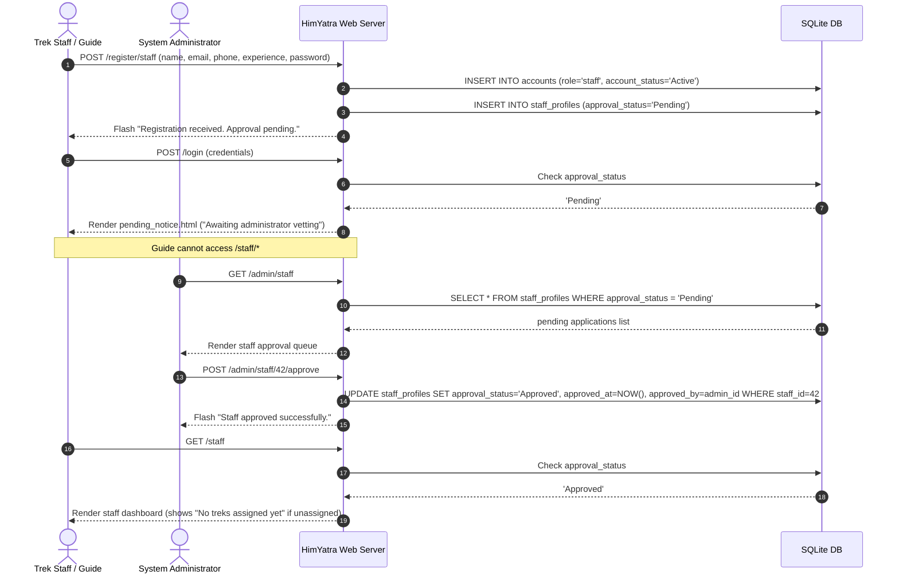
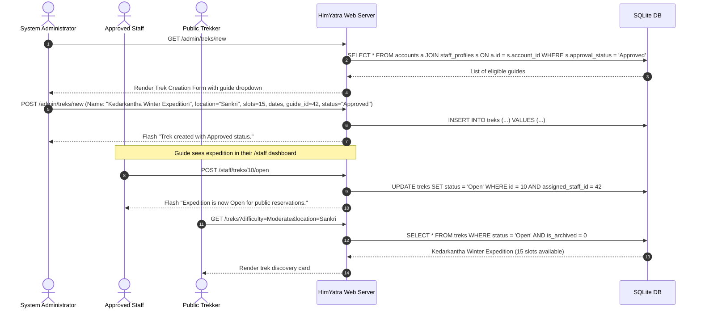
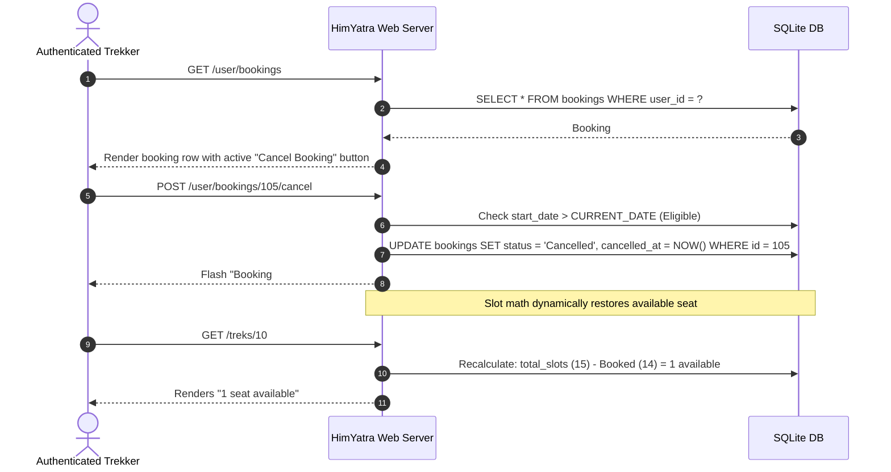
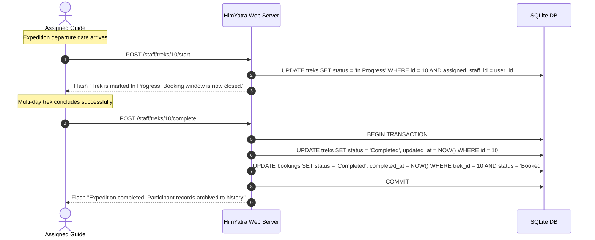
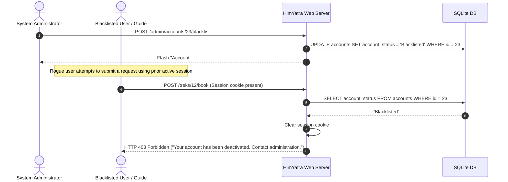

# End-to-End User Flows & Operational Scenarios

**Product Name:** HimYatra  
**Category:** Himalayan Trekking & Expedition Operations Management System  

---

## 1. Flow A: Staff Registration, Administrative Vetting & Approval



---

## 2. Flow B: Trek Creation, Guide Assignment & Public Launch



---

## 3. Flow C: Trekker Reservation & Concurrency Contention

```mermaid
sequenceDiagram
    autonumber
    actor Trekker1 as Trekker 1
    actor Trekker2 as Trekker 2
    participant Web as HimYatra App
    participant DB as SQLite DB (Exclusive Lock)

    Note over DB: Trek 10 has total_slots = 15, Booked count = 14 (1 slot remaining)
    
    Trekker1->>Web: POST /treks/10/book
    Trekker2->>Web: POST /treks/10/book (Fraction of a second later)
    
    Web->>DB: BEGIN IMMEDIATE; (Acquired by Trekker 1)
    Web->>DB: Check duplicate booking (None)
    Web->>DB: Check capacity: 15 - 14 = 1 seat available
    Web->>DB: INSERT INTO bookings (user_id=8, trek_id=10, status='Booked')
    Web->>DB: COMMIT;
    Web-->>Trekker1: Flash "Booking Confirmed! Reservation #105"

    Note over Web,DB: Trekker 2 transaction executes immediately after lock release
    Web->>DB: BEGIN IMMEDIATE; (Acquired by Trekker 2)
    Web->>DB: Check duplicate booking (None)
    Web->>DB: Check capacity: 15 - 15 = 0 seats available
    Web->>DB: ROLLBACK;
    Web-->>Trekker2: Flash "Trek is fully booked. No remaining seats."
```

---

## 4. Flow D: Self-Service Cancellation & Slot Reallocation



---

## 5. Flow E: Expedition Dispatch (In Progress) & Completion Workflow



---

## 6. Flow F: Account Blacklisting & Session Termination


